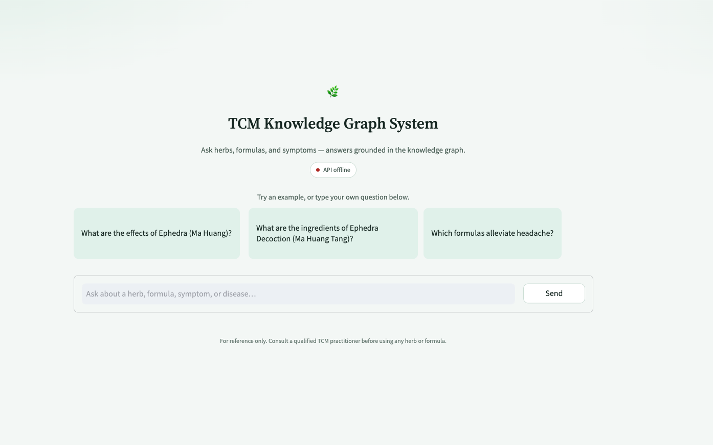
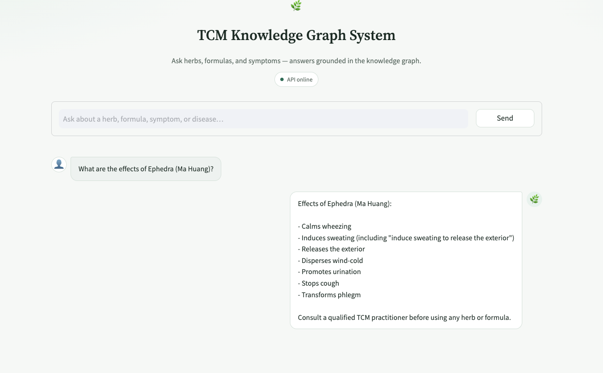

# TCM Knowledge Graph System

**Traditional Chinese Medicine Knowledge-Graph Question Answering**

## Tech Stack

- **Language:** Python
- **API:** FastAPI, uvicorn, Pydantic
- **Frontend:** Streamlit
- **Workflow:** LangGraph, LangChain
- **LLM:** OpenAI-compatible chat API (`langchain-openai`)
- **Graph database:** Neo4j 5.x (Bolt) + APOC
- **Vector / embeddings:** FAISS, Sentence-Transformers
- **Crawler:** Requests, BeautifulSoup, Playwright
- **Data:** pandas, numpy
- **Runtime:** Docker Compose (Neo4j), python-dotenv

## What It Does

Builds a TCM knowledge graph from herb/formula sources and answers natural-language questions with answers grounded in Neo4j retrieval, served through FastAPI and a Streamlit chat UI.

Private prompts, schemas, selectors, matching thresholds, and workflow parameters live in `common/.env` (see `.env.example`). Do not commit that file.

---

## Setup

All commands below assume you start from the `Knowledge-Graph/` directory.

### Install Dependencies

```bash
pip install -r requirements.txt
```

### Configure Environment

```bash
cp .env.example common/.env
```

Fill in LLM, Neo4j, embedding path, and all private tech keys listed in `.env.example` (prompts, `TCM_METADATA`, entity maps, crawler selectors, etc.).

### Start Neo4j

```bash
docker compose up -d
```

Wait until healthy, then confirm:

```bash
docker ps
```

| Container | Image | Host ports | Purpose |
| --- | --- | --- | --- |
| `neo4j` | `neo4j:5.26` (+ APOC) | `7474` (Browser), `7687` (Bolt) | Graph store |

Open Neo4j Browser at `http://localhost:7474`. Align `NEO4J_*` in `common/.env` with the compose auth settings.

### Run API + Streamlit

One command starts FastAPI, waits until it is healthy, then starts Streamlit. `Ctrl+C` stops both.

```bash
bash start.sh
```

| Service | URL |
| --- | --- |
| Streamlit UI | `http://localhost:8501` (or `STREAMLIT_PORT`) |
| FastAPI | `http://localhost:8000` (or `FASTAPI_PORT`) |
| Swagger docs | `http://localhost:8000/docs` |

Ports and `API_BASE_URL` come from `common/.env`. The sidebar can override `API_BASE_URL` and run a health check. The **Stream thinking** toggle (on by default) calls `/process_stream` and shows each graph node live, collapsing the steps once the answer arrives; turn it off to use `/process`.

To run either process alone:

```bash
python fastapi/main.py
bash streamlit/start_streamlit.sh
```

Smoke test (API must be up):

```bash
python fastapi/test_api.py
```

Landing page:

<p></p>

Example turn:

<p></p>

Each browser session gets a `user_id` (`web-<uuid>`). **New chat** clears local message history only.
